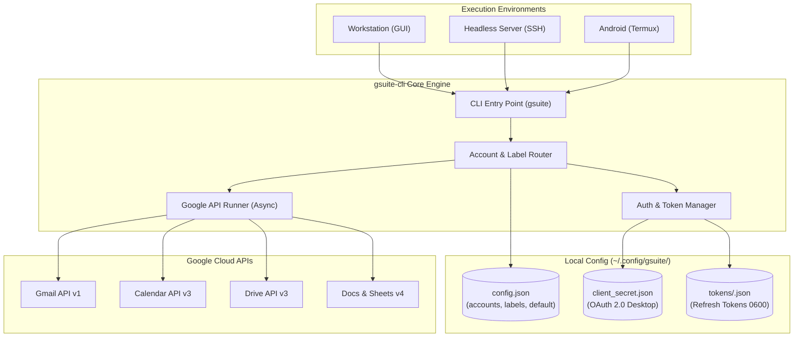
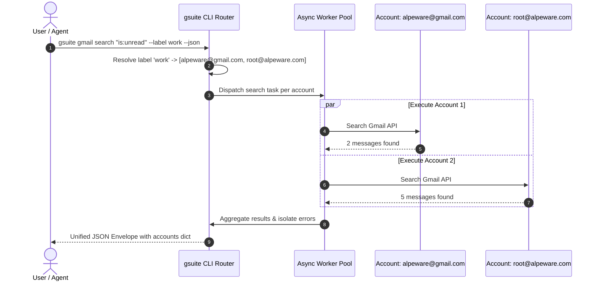
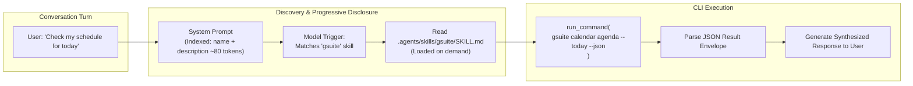

# gsuite-cli Architecture & Implementation Design

`gsuite-cli` is a high-performance, modular command-line interface and Google Antigravity (`agy`) progressive disclosure skill. It provides unified, multi-account access to Google Workspace and consumer Gmail accounts across Linux workstations, laptops, remote servers, and Android (Termux) mobile nodes.

---

## 1. Overview & Motivation

### 1.1 The Context-Bloat Problem of MCP Servers
Model Context Protocol (MCP) servers have become popular for connecting AI agents to external services. However, integrating Google Workspace through monolithic MCP servers (e.g., exposing 50+ tool definitions across Gmail, Calendar, Drive, and Sheets) introduces severe operational penalties:
* **Context Overhead:** Tool schemas are continuously injected into the agent's context window on every turn, consuming 3,000–8,000 tokens before any reasoning occurs.
* **Token Inefficiency & Cost:** Re-evaluating large tool definitions degrades prompt caching and dramatically increases token latency and inference costs.
* **Rigid Account Multiplexing:** Most MCP servers assume a single active user or require running separate server processes per account, making multi-account and cross-domain orchestration cumbersome.
* **Brittle State Management:** Long-lived MCP processes can silently drop authentication sessions, hang on network transitions, or fail silently during headless operation.

### 1.2 The CLI + Progressive Skill Approach
`gsuite-cli` solves this by decoupling API execution from agent reasoning:
1. **Lightweight Skill (`SKILL.md`):** Uses Antigravity's progressive disclosure. The agent context receives only a concise (~100 token) index entry. Detailed CLI recipes and schemas are read on-demand only when a Google Workspace task is triggered.
2. **Deterministic CLI Execution:** The agent interacts with Google APIs via standard bash commands (`gsuite gmail search ... --json`), offloading API parsing, pagination, batching, and OAuth token refreshing to a local Python binary.
3. **Structured Dual-Mode Output:** Commands output human-friendly terminal rendering (ANSI tables, colors, Markdown) by default for interactive human use, or deterministic, parseable JSON via `--json` for AI agents.

### 1.3 Heterogeneous Multi-Account Workflows
Users frequently operate across multiple distinct Google identities:
* **Consumer Accounts:** e.g., personal `@gmail.com` addresses.
* **Corporate Workspace Domains:** e.g., enterprise Google Workspace accounts like `root@alpeware.com`.
* **Organizational / Non-profit Domains:** e.g., foundations, client accounts, or project-specific emails.

> [!IMPORTANT]
> **Domain-Wide Delegation (Service Accounts) is insufficient** because it only works on Workspace enterprise domains with Super Admin privileges and fails completely on consumer `@gmail.com` accounts. `gsuite-cli` relies on **OAuth 2.0 Desktop Application** authorization, providing a unified authorization model that works identically across consumer Gmail and all Workspace tiers.

### 1.4 Cluster-Ready & Headless Design
The CLI is built to run seamlessly across heterogeneous environments:
* **Workstations & Laptops:** Ubuntu / Arch / Debian desktop nodes with GUI browsers for instant loopback OAuth.
* **Headless Servers & Devboxes:** Remote VMs connected via SSH without an X11/Wayland display server.
* **Mobile Devices (Android Termux):** Local execution on phone terminals without desktop browsers, supporting manual out-of-band authorization code pasting.



---

## 2. Flexible Multi-Account & Label System

### 2.1 Configuration Schema (`~/.config/gsuite/config.json`)
Configuration is maintained in standard XDG path `~/.config/gsuite/config.json` with strict `0600` permissions.

```json
{
  "version": "1.0",
  "default_account": "alpeware@gmail.com",
  "accounts": {
    "alpeware@gmail.com": {
      "alias": "alpe-personal",
      "labels": ["personal", "alpeware", "primary"],
      "token_file": "~/.config/gsuite/tokens/alpeware@gmail.com.json",
      "scopes": [
        "https://www.googleapis.com/auth/gmail.modify",
        "https://www.googleapis.com/auth/calendar",
        "https://www.googleapis.com/auth/drive.readonly"
      ],
      "created_at": "2026-10-11T09:15:00Z"
    },
    "root@alpeware.com": {
      "alias": "alpe-work",
      "labels": ["work", "alpeware", "workspace"],
      "token_file": "~/.config/gsuite/tokens/root@alpeware.com.json",
      "scopes": [
        "https://www.googleapis.com/auth/gmail.modify",
        "https://www.googleapis.com/auth/calendar",
        "https://www.googleapis.com/auth/drive",
        "https://www.googleapis.com/auth/documents",
        "https://www.googleapis.com/auth/spreadsheets"
      ],
      "created_at": "2026-10-11T09:20:00Z"
    },
    "foundation@nonprofit.org": {
      "alias": "foundation",
      "labels": ["foundation", "nonprofit", "work"],
      "token_file": "~/.config/gsuite/tokens/foundation@nonprofit.org.json",
      "scopes": [
        "https://www.googleapis.com/auth/gmail.readonly",
        "https://www.googleapis.com/auth/calendar.readonly"
      ],
      "created_at": "2026-10-11T09:25:00Z"
    }
  },
  "settings": {
    "output_format": "auto",
    "timeout_seconds": 30,
    "max_results_default": 20,
    "concurrency_limit": 5
  }
}
```

### 2.2 Account Targeting & Resolution Precedence
Commands resolve target accounts via four mutually exclusive modes:

1. **Explicit Account (`--account <email|alias>`):**
   * Matches against either the canonical email address or configured alias.
   * Executes against exactly one account.
   * Example: `gsuite gmail search "urgent" --account alpe-work`

2. **Label Grouping (`--label <label>`):**
   * Filters the accounts dictionary for any account where `labels` contains `<label>`.
   * Fan-out execution across all matching accounts in parallel.
   * Example: `gsuite calendar agenda --label work` (aggregates calendar events from both `root@alpeware.com` and `foundation@nonprofit.org`).

3. **Global Fan-out (`--all`):**
   * Fan-out execution across *every* configured account.
   * Example: `gsuite gmail search "is:unread" --all --json`

4. **Default Fallback (No flag passed):**
   * When none of `--account`, `--label`, or `--all` is specified, the CLI targets the `default_account` configured in `config.json`.
   * Example: `gsuite gmail search "is:unread"` targets `alpeware@gmail.com`.

### 2.3 Fan-Out Execution & Error Isolation
When targeting multiple accounts (`--label` or `--all`):
* **Concurrent Execution:** Uses `asyncio.gather` with an account-level semaphore (`concurrency_limit: 5`) to prevent hitting Google client rate limits.
* **Fault Isolation:** An authentication error or rate limit (HTTP 429) on one account does not fail the entire command. Successful accounts return data, while failed accounts report structured error objects.
* **Deterministic Aggregation:** Outputs are grouped by account identifier in both JSON and terminal views.



---

## 3. Authentication Architecture

### 3.1 OAuth 2.0 Desktop Application Model
`gsuite-cli` utilizes a single GCP OAuth 2.0 Client ID configured as a **Desktop Application**.
* **Credentials Path:** `~/.config/gsuite/client_secret.json`
* **Portability:** The client secret can be generated once in a Google Cloud Console project (owned by the user) and shared across all devices (`ultimatebeast`, `slimbeast`, phone).
* **Cross-Domain:** Allows authorizing both standard `@gmail.com` accounts and Workspace accounts with arbitrary domain names without requiring Workspace marketplace installation.

```json
{
  "installed": {
    "client_id": "1234567890-abcdefg.apps.googleusercontent.com",
    "project_id": "gsuite-cli-local",
    "auth_uri": "https://accounts.google.com/o/oauth2/auth",
    "token_uri": "https://oauth2.googleapis.com/token",
    "auth_provider_x509_cert_url": "https://www.googleapis.com/oauth2/v1/certs",
    "client_secret": "GOCSPX-xxxxxxxxxxxxxxxxxxxxxxxx",
    "redirect_uris": ["http://localhost", "urn:ietf:wg:oauth:2.0:oob"]
  }
}
```

### 3.2 Dual Authentication Flows

#### Flow A: Desktop Browser Loopback (Interactive GUI)
Used when a local display server and web browser are present:
1. The CLI spins up a temporary HTTP server on `http://localhost:<random-port>`.
2. Generates an authorization URL with PKCE (`code_challenge`) and random `state`.
3. Opens the system browser via `webbrowser.open()`.
4. The user completes Google login and grants permissions.
5. Google redirects to `http://localhost:<random-port>/?code=...&state=...`.
6. The CLI captures the authorization code, exchanges it for access and refresh tokens, serves an HTML success confirmation page, and terminates the temporary HTTP server.

#### Flow B: Headless / Out-Of-Band (SSH & Android Termux)
Triggered via `--headless` or auto-detected when `os.environ.get("DISPLAY")` is absent and `sys.stdin.isatty()`:
1. The CLI generates an authorization URL with loopback or manual redirect `http://localhost:8085/`.
2. Outputs the authorization URL directly to the terminal with clear instructions:
   ```text
   Open the following URL in any browser:
   https://accounts.google.com/o/oauth2/auth?...

   After authorizing, paste the callback URL or authorization code here:
   Enter code: 
   ```
3. The user opens the URL on any machine (e.g., laptop browser or phone browser), authorizes, and copies the authorization code or full redirect URL back into the terminal.
4. The CLI extracts the `code` parameter, completes the token exchange, and writes the token file.

### 3.3 Token Security & Lifecycle Management
* **File Locations:** Individual tokens are stored at `~/.config/gsuite/tokens/<email>.json`.
* **Filesystem Permissions:** 
  * Token directory `~/.config/gsuite/tokens/` is created with permissions `0700` (`drwx------`).
  * Token files are written with permissions `0600` (`-rw-------`).
  * On every invocation, `gsuite-cli` verifies permissions and enforces `0600` if relaxed.
* **Automatic Refresh:** Access tokens expire after 3,600 seconds (1 hour). Before making any Google API call, the client checks `credentials.expired`. If expired, it triggers `credentials.refresh(Request())` using the stored refresh token and writes the updated access token back to disk atomically.

### 3.4 Granular OAuth Scopes
To support the principle of least privilege, `gsuite auth add` supports predefined scope profiles:

| Profile | Scopes Included | Purpose |
| :--- | :--- | :--- |
| **`read-only`** | `gmail.readonly`<br>`calendar.readonly`<br>`drive.readonly` | Safe agent queries, auditing, no modification risk. |
| **`standard`** *(Default)* | `gmail.modify`<br>`calendar.events`<br>`drive.file`<br>`documents`<br>`spreadsheets` | Read/write emails, manage calendar events, read/edit docs and sheets. |
| **`full`** | `gmail.send`<br>`gmail.modify`<br>`calendar`<br>`drive` | Unrestricted access including background email sending and full Drive control. |
| **Custom** | User-specified URL list via `--scope <url>` | Precision access control. |

---

## 4. CLI Command Surface & Output Specification

### 4.1 Global Flags & Options
All commands inherit the following flags:
* `-a, --account <email|alias>`: Target specific account.
* `-l, --label <label>`: Target all accounts tagged with `<label>`.
* `--all`: Target all registered accounts.
* `--json`: Emit deterministic JSON envelope to `stdout`.
* `--plain`: Emit clean tab/plain text without ANSI styling.
* `--dry-run`: Validate parameters and preview actions without modifying remote state.
* `-v, --verbose`: Display debug logs and network traces to `stderr`.
* `-q, --quiet`: Suppress non-essential informational banners.

### 4.2 Command Hierarchy

```text
gsuite
├── auth
│   ├── add <email>            # Register and authenticate an account
│   ├── list                   # Display configured accounts, health, and labels
│   ├── remove <email>         # Revoke token and remove account config
│   ├── test                   # Validate tokens and check API reachability
│   ├── default <email>        # Set the fallback default account
│   └── labels
│       ├── add <email> <l>    # Add label(s) to account
│       ├── remove <email> <l> # Remove label from account
│       └── list               # List all known labels and associated accounts
├── gmail
│   ├── search <query>         # Search messages (Gmail search syntax)
│   ├── read <message_id>      # Read full email body and attachment metadata
│   ├── threads <thread_id>    # Display entire email thread
│   ├── draft create           # Create an email draft
│   ├── send                   # Send email directly (requires --confirm or prompt)
│   └── modify <message_id>    # Add/remove Gmail labels, mark read/unread, archive
├── calendar
│   ├── agenda                 # Quick list of upcoming events for next N days
│   ├── events                 # Search and filter events in date range
│   ├── freebusy               # Check availability across multiple participants
│   └── create                 # Schedule a new calendar event
└── drive
    ├── search <query>         # Search Drive files by name/metadata
    ├── export <file_id>       # Export Google Doc/Sheet to local file (pdf/txt/csv)
    ├── docs read <file_id>    # Fetch Google Doc and render as clean Markdown
    └── sheets
        ├── read <sheet_id>    # Read range/sheet as JSON, CSV, or formatted table
        └── append <sheet_id>  # Append rows to a spreadsheet
```

### 4.3 Detailed Subcommand Specifications

#### `gsuite auth`
```bash
# Add a new account using interactive browser loopback
gsuite auth add alpeware@gmail.com --alias alpe-personal --labels personal,primary

# Add an account in a headless SSH/Termux environment with standard scopes
gsuite auth add root@alpeware.com --alias alpe-work --labels work,alpeware --headless --scopes standard

# Test all account tokens and print connectivity status table
gsuite auth test --all

# Add a label to an existing account
gsuite auth labels add root@alpeware.com devops
```

#### `gsuite gmail`
```bash
# Search unread messages from a specific sender across all work accounts
gsuite gmail search "is:unread from:stripe.com" --label work --limit 10

# Read an email by message ID and decode MIME body as markdown
gsuite gmail read 18da4c8f0a2e3 --format markdown

# Create a draft email with confirmation
gsuite gmail draft create \
  --account alpe-work \
  --to "partner@example.com" \
  --subject "Project Update Q4" \
  --body "Here is the summary of our milestones..."

# Send email with dry-run check
gsuite gmail send \
  --account alpe-work \
  --to "partner@example.com" \
  --subject "Final Invoice" \
  --body "Attached is the invoice." \
  --attach "/path/to/invoice.pdf" \
  --dry-run
```

#### `gsuite calendar`
```bash
# Display today's agenda across all accounts
gsuite calendar agenda --today --all

# Search events for the next 7 days matching a query
gsuite calendar events --days 7 --query "Sprint Planning" --account alpe-work

# Query free/busy schedule before booking a meeting
gsuite calendar freebusy \
  --emails "alice@example.com,bob@example.com" \
  --start "2026-10-12T09:00:00Z" \
  --end "2026-10-12T17:00:00Z"

# Create a calendar event with attendees
gsuite calendar create \
  --account alpe-work \
  --summary "Architecture Review" \
  --start "2026-10-12T14:00:00-05:00" \
  --end "2026-10-12T15:00:00-05:00" \
  --attendees "team@alpeware.com" \
  --description "Review gsuite-cli technical specification."
```

#### `gsuite drive / docs / sheets`
```bash
# Search for spreadsheets modified in the last 30 days
gsuite drive search "mimeType='application/vnd.google-apps.spreadsheet' and modifiedTime > '2026-09-11T00:00:00'" --account alpe-work

# Export a Google Doc directly as Markdown
gsuite docs read 1AbC-xYz1234567890 --markdown

# Read a range from a Google Sheet as JSON
gsuite sheets read 1SheetIdExample --range "Q4_Metrics!A1:E20" --json

# Append a row of data to a Google Sheet
gsuite sheets append 1SheetIdExample --range "AuditLog!A1" --values '["2026-10-11T09:30:00Z", "deploy", "success"]'
```

### 4.4 Deterministic Output Format (`--json`)
When `--json` is supplied, stdout contains *only* valid JSON. Informational logs, progress tickers, and token refresh notices are redirected to `stderr`.

#### Single Account Output Example
```json
{
  "status": "success",
  "account": "root@alpeware.com",
  "query": "is:unread",
  "count": 1,
  "data": [
    {
      "id": "18f92b7c4d5e0123",
      "threadId": "18f92b7c4d5e0123",
      "from": "alerts@github.com",
      "to": "root@alpeware.com",
      "subject": "[GitHub] Security Advisory for repo gsuite-cli",
      "date": "2026-10-11T08:45:12Z",
      "snippet": "A new dependency vulnerability was detected...",
      "labels": ["UNREAD", "INBOX", "IMPORTANT"]
    }
  ],
  "errors": null
}
```

#### Fan-Out Multi-Account Output Example (`--label work`)
```json
{
  "status": "multi_account_success",
  "target_label": "work",
  "accounts_targeted": 2,
  "total_count": 3,
  "results": {
    "root@alpeware.com": {
      "status": "success",
      "count": 2,
      "data": [ ... ]
    },
    "foundation@nonprofit.org": {
      "status": "error",
      "error_code": "TOKEN_EXPIRED",
      "message": "Token expired and refresh token revoked. Run 'gsuite auth add foundation@nonprofit.org' to re-authenticate."
    }
  }
}
```

---

## 5. Antigravity (`agy`) Skill Integration

### 5.1 Skill Architecture & Progressive Disclosure
The `gsuite` skill is located in `.agents/skills/gsuite/SKILL.md` (or globally in `~/.gemini/antigravity-cli/skills/gsuite/SKILL.md`).

Under Antigravity's progressive disclosure architecture:
1. **Initial Indexing:** Only the YAML frontmatter (`name` and `description`) is injected into the model's system prompt. This costs **~80 tokens**, compared to **~4,000 tokens** for an equivalent MCP server.
2. **On-Demand Activation:** When the user asks a question involving Gmail, calendar schedules, or Google Drive documents, the model activates the skill and reads the full instruction set.



### 5.2 Antigravity Skill Specification (`.agents/skills/gsuite/SKILL.md`)

```markdown
---
name: gsuite
description: >-
  Interact with Google Workspace and consumer Gmail accounts using gsuite-cli.
  Use to search and read emails, inspect threads, draft and send messages, check
  calendar agendas and schedules, query free/busy slots, and read or export Drive,
  Docs, and Sheets across single accounts, labels (e.g. --label work), or --all.
---

# Google Workspace & Gmail Skill (gsuite-cli)

This skill enables Antigravity agents to interact with Google Workspace and Gmail
accounts via the `gsuite` CLI.

## Guiding Principles for Agents
1. **Always Use `--json`:** When executing read commands (`search`, `read`, `agenda`, `events`, `sheets read`), append `--json` to obtain structured, parseable data.
2. **Account Targeting Discipline:**
   - Use `--account <email|alias>` if the user specifies a specific identity or context.
   - Use `--label <label>` (e.g. `--label work`, `--label personal`) when operating across an organization or functional area.
   - Use `--all` only when searching broadly across all configured accounts.
   - Omit flags to fall back to the user's configured `default_account`.
3. **Safety on Write Operations:**
   - Never send an email (`gsuite gmail send`) or delete/modify events without explicit confirmation or user approval.
   - Prefer creating a draft with `gsuite gmail draft create` so the user can review before dispatching.
   - Use `--dry-run` to preview actions whenever available.

## Quick Command Recipes

### Gmail Workflows
```bash
# Check unread messages across all work accounts
gsuite gmail search "is:unread" --label work --limit 10 --json

# Read a specific email thread
gsuite gmail read <message_id> --format markdown --json

# Draft a reply or new message
gsuite gmail draft create \
  --account alpe-work \
  --to "client@example.com" \
  --subject "Re: Project Specs" \
  --body "Draft text here..."
```

### Calendar Workflows
```bash
# View today's agenda across all accounts
gsuite calendar agenda --today --all --json

# Check availability for tomorrow afternoon
gsuite calendar freebusy \
  --emails "colleague@example.com" \
  --start "2026-10-12T13:00:00Z" \
  --end "2026-10-12T18:00:00Z" --json

# Create calendar event
gsuite calendar create \
  --account alpe-work \
  --summary "Team Sync" \
  --start "2026-10-12T15:00:00-05:00" \
  --end "2026-10-12T15:30:00-05:00" \
  --attendees "dev@example.com"
```

### Drive & Docs Workflows
```bash
# Read a Google Doc as clean Markdown
gsuite docs read <file_id> --markdown

# Query tabular data from Google Sheets
gsuite sheets read <sheet_id> --range "Sheet1!A1:D15" --json
```
```

---

## 6. Repository Scaffolding & Python Packaging

### 6.1 Python Packaging with `uv`
The project uses PEP 621 packaging metadata in `pyproject.toml`, managed with `uv` for ultra-fast dependency resolution and virtualenv creation.

```toml
[build-system]
requires = ["hatchling"]
build-backend = "hatchling.build"

[project]
name = "gsuite-cli"
version = "0.1.0"
description = "Lightweight multi-account CLI and Antigravity skill for Google Workspace and Gmail"
readme = "README.md"
requires-python = ">=3.11"
license = { text = "MIT" }
authors = [
    { name = "Alpeware", email = "info@alpeware.com" }
]
dependencies = [
    "google-api-python-client>=2.140.0",
    "google-auth-httplib2>=0.2.0",
    "google-auth-oauthlib>=1.2.1",
    "google-auth>=2.34.0",
    "click>=8.1.7",
    "rich>=13.8.0",
    "pydantic>=2.8.0",
    "pydantic-settings>=2.4.0",
    "httpx>=0.27.0"
]

[project.optional-dependencies]
dev = [
    "pytest>=8.3.0",
    "pytest-asyncio>=0.24.0",
    "pytest-mock>=3.14.0",
    "ruff>=0.6.0",
    "mypy>=1.11.0"
]

[project.scripts]
gsuite = "gsuite_cli.main:main"

[tool.hatch.build.targets.wheel]
packages = ["src/gsuite_cli"]

[tool.pytest.ini_options]
asyncio_mode = "auto"
testpaths = ["tests"]
```

### 6.2 Source Tree Structure
```text
gsuite-cli/
├── .agents/
│   └── skills/
│       └── gsuite/
│           └── SKILL.md                  # agy progressive disclosure skill
├── .gitignore
├── DESIGN.md                             # Comprehensive architecture design
├── README.md                             # User setup and quickstart guide
├── pyproject.toml                        # PEP 621 project configuration
├── src/
│   └── gsuite_cli/
│       ├── __init__.py                   # Package version and export
│       ├── main.py                       # Click CLI entry point and root group
│       ├── config.py                     # Config schema, validation, ~/.config/gsuite loader
│       ├── exceptions.py                 # Typed exceptions (AuthError, RateLimitError, etc.)
│       ├── auth/
│       │   ├── __init__.py
│       │   ├── oauth.py                  # Loopback and headless out-of-band flows
│       │   ├── token_store.py            # Token persistence, permission checks (0600)
│       │   └── scopes.py                 # Scope profiles and URL constants
│       ├── router/
│       │   ├── __init__.py
│       │   ├── resolver.py               # --account, --label, --all targeting logic
│       │   └── executor.py               # Concurrent multi-account async runner
│       ├── services/
│       │   ├── __init__.py
│       │   ├── base.py                   # Base Google API service wrapper & retry logic
│       │   ├── gmail.py                  # Search, read, thread, draft, send, modify
│       │   ├── calendar.py               # Agenda, events, freebusy, create
│       │   ├── drive.py                  # Search, export
│       │   └── docs_sheets.py            # Docs markdown conversion, Sheets read/append
│       ├── formatters/
│       │   ├── __init__.py
│       │   ├── json_out.py               # Standardized JSON response envelopes
│       │   └── rich_out.py               # Rich tables, Markdown, agenda trees
│       └── commands/
│           ├── __init__.py
│           ├── auth_cmd.py               # 'gsuite auth' commands
│           ├── gmail_cmd.py              # 'gsuite gmail' commands
│           ├── calendar_cmd.py           # 'gsuite calendar' commands
│           └── drive_cmd.py              # 'gsuite drive/docs/sheets' commands
└── tests/
    ├── conftest.py                       # Fixtures for mock credentials and config
    ├── test_config.py                    # Config validation and loading tests
    ├── test_auth.py                      # Token storage, permission enforcement tests
    ├── test_router.py                    # Account, label, and fan-out targeting tests
    ├── test_gmail.py                     # Gmail command unit tests
    ├── test_calendar.py                  # Calendar agenda and freebusy tests
    └── test_formatters.py                # JSON envelope and Rich output tests
```

### 6.3 Development & Test Strategy

#### Virtual Environment & Tooling
```bash
# Create and activate virtual environment via uv
uv venv
source .venv/bin/activate

# Install package in editable mode with development dependencies
uv pip install -e ".[dev]"

# Run code formatting and linting
ruff check src tests
ruff format src tests

# Run static type checking
mypy src
```

#### Unit & Integration Testing
* **Test Isolation:** Tests use `pytest-mock` and fake credential dictionaries; no real Google network calls occur during unit testing.
* **Targeting Tests (`test_router.py`):**
  - Verify that `--account <alias>` resolves to the correct email.
  - Verify that `--label work` accurately filters and fans out to all matching accounts.
  - Verify that `--all` enumerates all accounts in `config.json`.
  - Verify that omitting flags defaults to `default_account`.
* **Security & Permission Tests (`test_auth.py`):**
  - Test that token files created with overly permissive bits (e.g. `0644`) are automatically corrected to `0600` or trigger warnings.
* **Output Envelope Tests (`test_formatters.py`):**
  - Verify that `--json` returns schema-valid envelopes without leaking `print()` statements to `stdout`.

---

## 7. Implementation Roadmap & Phased Execution

| Phase | Milestone | Deliverables |
| :---: | :--- | :--- |
| **Phase 1** | **Core Foundation & Auth** | • Project scaffolding (`pyproject.toml`, directory tree)<br>• Config schema & persistence (`~/.config/gsuite/config.json`)<br>• OAuth Desktop client: Loopback + Headless out-of-band auth<br>• Token storage with enforced `0600` permissions<br>• `gsuite auth` command family (`add`, `list`, `remove`, `test`, `labels`) |
| **Phase 2** | **Targeting Router & Gmail Service** | • Account and label resolver (`--account`, `--label`, `--all`)<br>• Parallel async execution pool with fault isolation<br>• Dual formatters (`--json` envelope and Rich tables/markdown)<br>• `gsuite gmail` commands (`search`, `read`, `threads`, `draft`, `send`, `modify`) |
| **Phase 3** | **Calendar & Drive / Docs / Sheets** | • `gsuite calendar` commands (`agenda`, `events`, `freebusy`, `create`)<br>• `gsuite drive` search & export<br>• `gsuite docs read --markdown`<br>• `gsuite sheets read/append` |
| **Phase 4** | **Antigravity Skill & Node Validation** | • Antigravity progressive disclosure skill (`.agents/skills/gsuite/SKILL.md`)<br>• End-to-end integration tests on workstation (`ultimatebeast`), laptop (`slimbeast`), and Android Termux<br>• Shell completion scripts (bash/zsh) |
